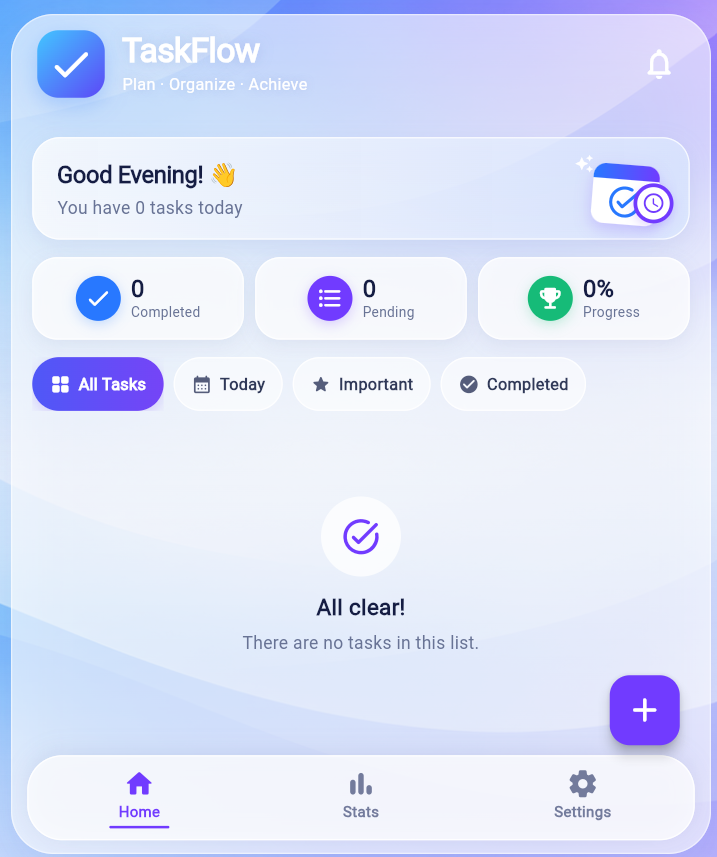
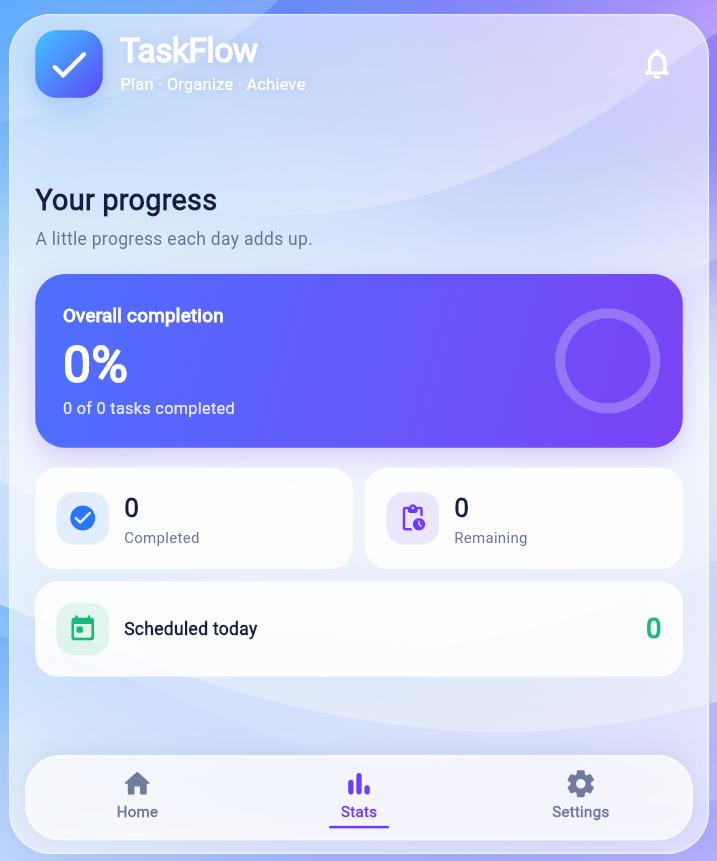
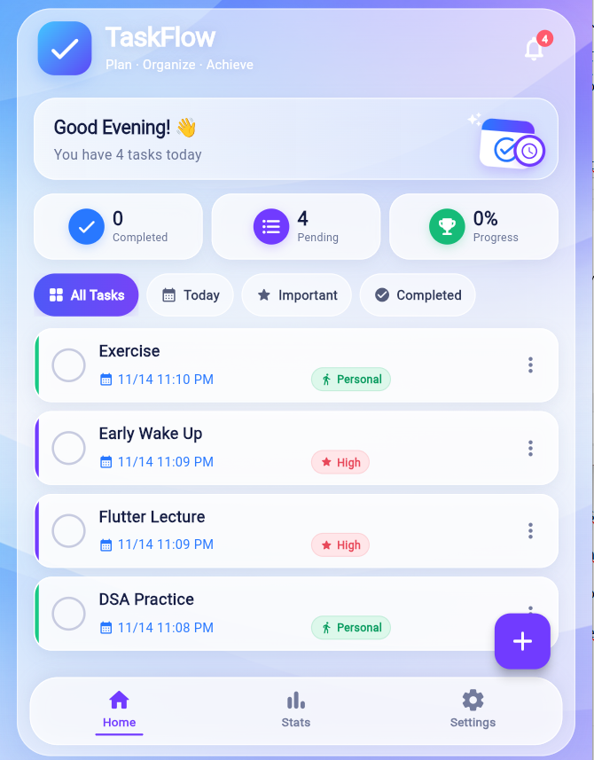
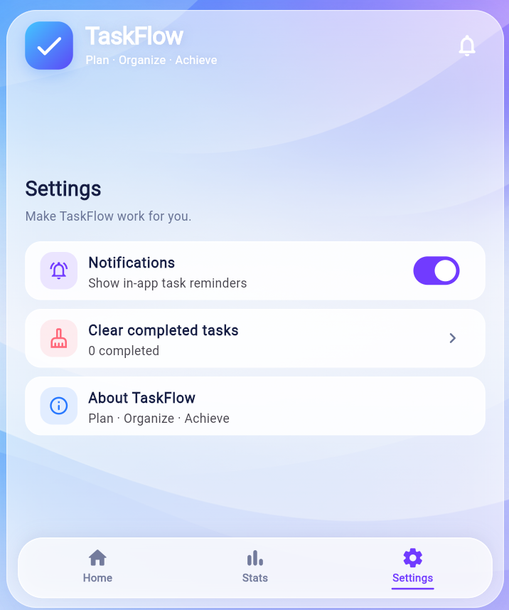

 # ✅ TaskFlow – To-Do List App

## 📱 Project Overview
TaskFlow is a Flutter-based To-Do List application designed to help users organize daily tasks, manage priorities, and track productivity with a clean and responsive interface.

## ✨ Features
- Add, Edit & Delete Tasks.
- Mark Tasks as Completed.
- Undo Deleted Tasks.
- Today, Important & Completed Filters.
- Task Categories (Personal & Work).
- Task Statistics & Progress Tracking.
- In-App Reminders.
- Clear Completed Tasks.
- Local Data Persistence.

## 🛠️ Tech Stack
- **Framework:** Flutter
- **Language:** Dart
- **Local Storage:** SharedPreferences
- **UI:** Material Design 3
- **Tools:** VS Code, Android Studio, Git & GitHub

## 📂 Folder Structure
```text
todo_app/
├── assets/
│   └── images/
│       └── todo.png
├── lib/
│   ├── models/
│   │   └── task.dart
│   ├── screens/
│   │   ├── todo_screen.dart
│   │   └── todo_screen/
│   │       ├── actions.dart
│   │       ├── header.dart
│   │       ├── home.dart
│   │       ├── notifications.dart
│   │       ├── pages.dart
│   │       └── task_editor.dart
│   ├── settings/
│   ├── theme/
│   ├── widgets/
│   └── main.dart
├── test/
├── pubspec.yaml
└── README.md
```

## 📸 Screenshots

| Home Screen | Statistics |
|---|---|
|  |  |

| Task Management | Settings |
|---|---|
|  |  |

## 🚀 Installation Steps

1. Clone the repository:
```bash
git clone <YOUR_REPOSITORY_URL>
```

2. Navigate to the project:
```bash
cd todo_app
```

3. Install dependencies:
```bash
flutter pub get
```

4. Run the application:
```bash
flutter run
```

## 👨‍💻 Author

**Bhupender**

- GitHub: [@bhupender1208](https://github.com/bhupender1208)
- LinkedIn: [Bhupender](https://www.linkedin.com/in/bhupender-00b134282/)